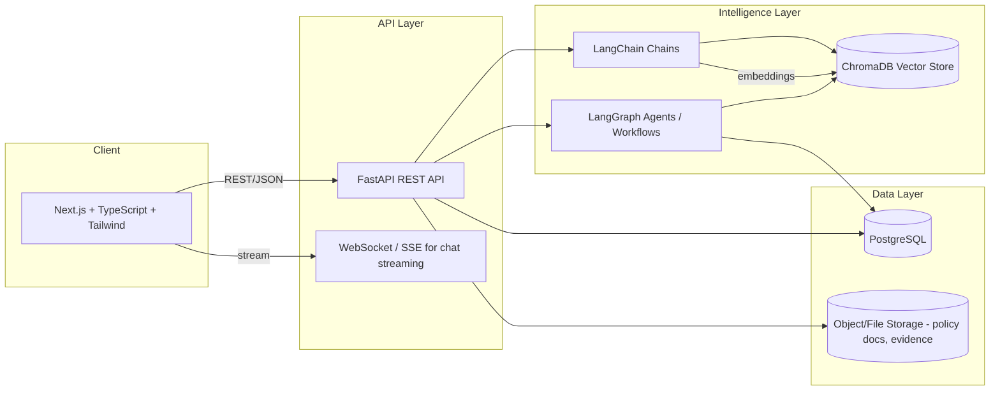

# AI Governance & Compliance Platform — Architecture

## 1. Overview
A platform that helps organizations govern AI systems: track policies, run
compliance checks, audit AI models/pipelines, and provide an AI-assisted
copilot (RAG + agentic workflows) for governance Q&A and document analysis.

## 2. High-Level Architecture

## 3. Core Domains
- **Auth & Users**: authentication, roles (Admin, Compliance Officer, Auditor, Viewer), org/tenant scoping.
- **Policies**: governance policies, versions, approval workflow.
- **AI Systems Registry**: catalog of AI/ML systems/models under governance, risk classification.
- **Compliance**: frameworks (e.g., EU AI Act, NIST AI RMF, ISO 42001), control mappings, assessments, findings.
- **Audits**: audit runs, evidence collection, findings, remediation tracking.
- **Documents & Evidence**: upload, chunk, embed into ChromaDB for retrieval across Regulations,
  Industry Standards, Audit Findings, Governance Documents, plus legacy Policies and Evidence collections.
- **AI Copilot / Chat**: RAG-based Q&A over policies & regulations using LangChain retrieval chains.
- **Agentic Workflows**: LangGraph state machines for multi-step compliance assessment (e.g., ingest doc -> classify risk -> map controls -> generate report -> human review).
- **Governance Agents (multi-agent)**: four specialist LangGraph agents — Legal Research, Compliance,
  Risk Evaluation, Governance Advisor — each with their own tools/prompt/memory, coordinated either by a
  supervisor orchestrator (routes to one best-matching specialist) or a fixed sequential collaboration
  pipeline: Research -> Compliance -> Risk -> Governance, where each agent builds on prior findings.
- **Observability & Audit Trail**: every collaboration run is traced (per-agent duration, tool/LLM/chain
  events) and persisted to Postgres for recommendation traceability; optional LangSmith tracing via env vars.
- **Dashboards & Reporting**: compliance score, risk heatmaps, audit trail.

## 4. Backend Architecture (FastAPI)
- Layered structure: `api` (routers/controllers) -> `services`/`rag`/`agents` (business logic) -> `models`/`schemas` (ORM + validation) -> `db` (session/engine).
- `agents/` houses LangGraph graphs (state, nodes, edges, tools) used by the copilot & automated compliance workflows,
  plus the Phase 3 multi-agent system:
  - `prompts.py` — system prompts per specialist and the supervisor.
  - `*_tools.py` (`compliance_tools.py`, `risk_tools.py`, `governance_tools.py`) + `tools.py` (RAG search tools) —
    sync, DB-backed LangChain tools (via `app/db/sync_session.py`) callable by any agent.
  - `agent_factory.py` — builds a reusable ReAct-style graph (agent node <-> `ToolNode`) per specialist.
  - `memory.py` — a shared `MemorySaver` checkpointer keyed by `thread_id` (session_id) for per-conversation memory.
  - `legal_research_agent.py`, `compliance_agent.py`, `risk_evaluation_agent.py`, `governance_advisor_agent.py` —
    the four specialist agents, each compiled with its own tools/prompt.
  - `orchestrator.py` — a supervisor `StateGraph` that classifies the user's message and routes it to exactly
    one specialist, then returns to `FINISH`; tracks which agent(s) handled the request in `agent_trace`.
  - `collaboration.py` — the Phase 5 **sequential collaboration pipeline** (Research -> Compliance -> Risk ->
    Governance): each stage receives the original query plus every prior stage's findings, so the Governance
    Agent synthesizes a final recommendation grounded in the full chain of reasoning.
  - `observability.py` — a `CollaborationTracer` callback handler capturing every chain/tool/LLM start-end
    event (name, truncated input/output, duration) for each agent invocation, independent of LangSmith.
  - `core/tracing.py` — enables LangSmith tracing (`LANGCHAIN_TRACING_V2`, project, API key/endpoint) when
    configured, so every chain/tool/LLM call in both the orchestrator and collaboration pipeline is traced.
  - Collaboration runs are persisted via `models/collaboration.py` (`AgentCollaborationRun` +
    `AgentCollaborationStep`), giving recommendation traceability and a queryable audit trail through
    `/api/v1/collaboration` (`POST /` to run, `GET /` to list past runs, `GET /{run_id}` for the full trace).
  - Exposed via `/api/v1/agents/{legal-research,compliance,risk-evaluation,governance-advisor,orchestrate}`.
- `rag/` is the standalone RAG pipeline: `loaders.py` (txt/pdf/docx extraction) -> `chunking.py` (recursive splitter) ->
  `embeddings.py` (OpenAI embeddings) -> `vectorstore.py` (ChromaDB via LangChain `Chroma`) -> `ingestion.py`
  (load/chunk/embed/store + delete) -> `retrieval.py` (similarity search with relevance scores) -> `citation.py`
  (numbered `[n]` source formatting) -> `chain.py` (prompt + LLM producing citation-grounded answers). Both the
  `/chat` and `/research/queries` endpoints, and the LangGraph `agents/nodes.py`, are built on top of this package.
- `mcp/` exposes the platform as standalone **MCP (Model Context Protocol) servers**, so any MCP-compatible
  client (VS Code, Claude Desktop, other agents) can call the same governance data/tools directly:
  - `policy_repository_server.py` — list/get/create policies, transition status, semantic search.
  - `compliance_tool_server.py` — frameworks, controls, assessments (create/update), dashboard aggregates.
  - `audit_system_server.py` — audits and findings (create/update/resolve), audit summary stats.
  - `document_management_server.py` — list/ingest/search/delete documents against ChromaDB collections.
  - Each is a `FastMCP` app (stdio transport) reusing `db/sync_session.py` and `rag/`; run individually via
    `python -m app.mcp.<name>_server`. See `.vscode/mcp.json` for editor integration.
- `alembic/` manages PostgreSQL migrations.
- Async SQLAlchemy 2.0 + asyncpg for non-blocking DB access.
- JWT-based auth with refresh tokens; RBAC via dependency injection.

## 5. Frontend Architecture (Next.js App Router)
- `app/` route groups: `(auth)`, `(dashboard)` with nested routes for policies, compliance, audits, ai-systems, chat.
- `components/ui` — design system primitives (Tailwind-based).
- `components/*` feature components co-located by domain.
- `lib/api.ts` — typed API client (fetch wrapper) hitting FastAPI.
- `store/` — client state (Zustand) for UI/session state; server state via React Query.
- `types/` — shared TypeScript types (mirrors backend Pydantic schemas).

## 6. Data Flow: Copilot RAG Query
1. User asks a question in chat UI (frontend).
2. Request hits `/api/v1/chat` (FastAPI), streamed via SSE/WebSocket.
3. LangChain retriever queries ChromaDB for relevant policy/regulation chunks.
4. LangGraph orchestrates: retrieve -> grade relevance -> generate answer -> cite sources -> (optional) compliance-check node.
5. Response streamed back to client with source citations.

## 7. Deployment
- `docker-compose.yml` orchestrates: `frontend`, `backend`, `postgres`, `chromadb`.
- Environment-based config via `.env` files (see `.env.example` in each app).

## 8. Tech Stack Summary
| Layer | Technology |
|---|---|
| Frontend | Next.js, TypeScript, Tailwind CSS |
| Backend API | FastAPI (Python), Pydantic v2 |
| Database | PostgreSQL (SQLAlchemy 2.0 async + Alembic) |
| AI Orchestration | LangChain, LangGraph |
| Vector Store | ChromaDB |
| Auth | JWT (OAuth2 password/bearer flow) |
| Infra | Docker, docker-compose |
